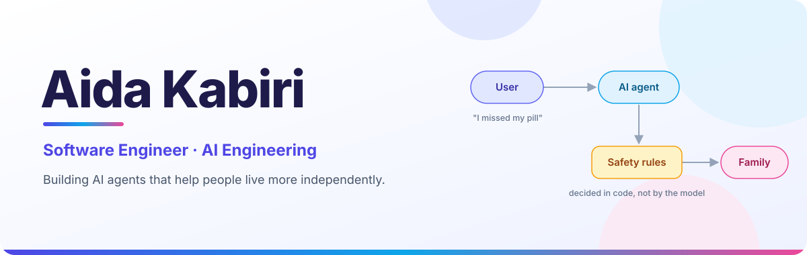
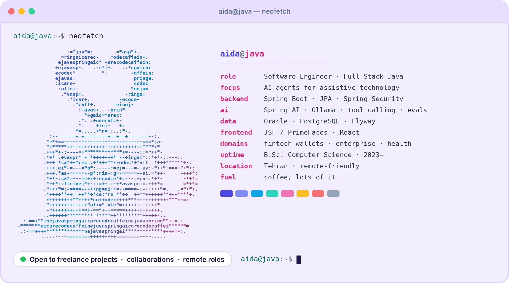
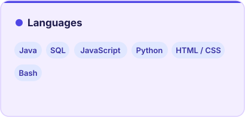
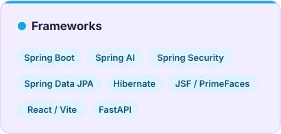
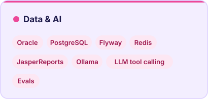
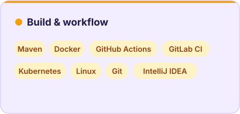

<div align="center">
  
</div>

<div align="center">
  
</div>

<div align="center">
  
  <a href="https://github.com/Ayda8?tab=followers"></a>
  
</div>


## 👩‍💻 About me

```java
var aida = new Developer(
    "Aida Kabiri",                                   // name
    "Software Engineer · Full-Stack Java · AI",      // role
    List.of("Java", "Spring Boot", "Spring AI"),     // daily drivers
    List.of("Oracle", "PostgreSQL"),                 // where the data lives
    "B.Sc. Computer Science, 2023 – present",        // education
    "AI agents for assistive technology",            // what I'm building
    "Tehran, Iran"                                   // based in
);
```

I'm a software engineer who builds products end to end: Java and Spring backends, database design and
queries, and web frontends. I've worked on enterprise information systems, and before that on digital
wallet, payment and transaction products. Now I'm taking that engineering discipline into LLM applications.

My current project is an AI agent that helps people with disabilities and older adults manage their
medication, and keeps their family in the loop. The rule I build by: **an LLM may talk, but it never
decides anything safety-critical.** Those decisions live in plain, tested Java code, and every change
to the agent is measured with evals before it ships.

<div align="center">
  
</div>

> `An LLM may talk. Only tested code decides.`


## 🚀 Projects

<table>
  <tr>
    <td width="50%" valign="top">
      <h3>💊 Caregiver Agent</h3>
      <p>An LLM agent that manages medication schedules and alerts caregivers. Runs fully local with Ollama and keeps working without internet. Safety rules in a deterministic rule engine, guarded by ArchUnit; evals before prompts.</p>
      <p><code>Java 21</code> <code>Spring Boot 3.5</code> <code>Spring AI</code> <code>Ollama</code> <code>Flyway</code></p>
      
    </td>
    <td width="50%" valign="top">
      <h3>📈 <a href="https://github.com/stupidprogrammer4/amu-pulse">Amu Pulse</a></h3>
      <p>Precious-metals price tracking with AI-scored market signals, built as a team. I built the identity module (JWT refresh tokens stored as SHA-256 hashes, login audit log) and the news crawler.</p>
      <p><code>Python</code> <code>FastAPI</code> <code>Dishka</code> <code>PostgreSQL</code></p>
    </td>
  </tr>
  <tr>
    <td width="50%" valign="top">
      <h3>🎓 University Management System</h3>
      <p>Enrollment with capacity and timetable-conflict checks, batch enrollment, weighted-GPA transcripts as PDFs, role-based access. Built in a structured mentorship program.</p>
      <p><code>Spring Boot</code> <code>JSF / PrimeFaces</code> <code>Oracle</code> <code>JasperReports</code></p>
    </td>
    <td width="50%" valign="top">
      <h3>🖼️ Lumina</h3>
      <p>An art gallery web app, made as a gift for a painter in my family.</p>
      <p><code>Spring Boot</code> <code>PostgreSQL</code> <code>JWT</code> <code>React / Vite</code> <code>Docker</code></p>
    </td>
  </tr>
</table>


## 🧰 Tech stack

<div align="center">
  
  
  <br>
  
  
</div>

<details>
  <summary><b>View the stack as text</b></summary>
  <p><b>Languages:</b> Java · SQL · JavaScript · Python · HTML / CSS · Bash</p>
  <p><b>Frameworks:</b> Spring Boot · Spring AI · Spring Security · Spring Data JPA · Hibernate · JSF / PrimeFaces · React / Vite · FastAPI</p>
  <p><b>Data &amp; AI:</b> Oracle · PostgreSQL · Flyway · Redis · JasperReports · Ollama · LLM tool calling · Evals</p>
  <p><b>Build &amp; workflow:</b> Maven · Docker · GitHub Actions · GitLab CI · Kubernetes · Linux · Git · IntelliJ IDEA</p>
</details>


## 📊 GitHub stats

<div align="center">
  <a href="https://github.com/Ayda8">
    
  </a>
  <a href="https://github.com/Ayda8?tab=repositories">
    
  </a>
</div>

<div align="center">
  
</div>

### 🏆 Trophies

<div align="center">
  
</div>

### 📈 Activity

<div align="center">
  
</div>

### 🐍 Contribution snake

<div align="center">
  <picture>
    <source media="(prefers-color-scheme: dark)" srcset="https://raw.githubusercontent.com/Ayda8/Ayda8/output/github-snake-dark.svg">
    
  </picture>
</div>


## 🏅 Competitions

<div align="center">

| Competition | Track | Result |
|:---|:---|:---:|
| **National Technology Olympiad 2026** · Islamic Azad University, Sari | DevOps / Linux | Final round |

</div>

> Docker, CI pipelines, Kubernetes and Prometheus / Grafana, under a clock.<br>
> It taught me that code isn't done until it runs somewhere other than my laptop.


## 🧭 How I work

> **Safety lives in code, not in prompts.** If a mistake can hurt someone, a tested rule decides, not a model.<br>
> **Measure before you tune.** Evals first, then prompts, then models.<br>
> **Write the decision down.** Every important choice gets an ADR, so future me knows *why*.


## 🤝 Work with me

<table>
  <tr>
    <td width="50%" valign="top">
      <b>⚙️ Backends &amp; APIs</b><br>
      <sub>Spring Boot services, REST APIs, auth with Spring Security, clean database design and migrations, tested and CI-ready.</sub>
    </td>
    <td width="50%" valign="top">
      <b>🤖 AI features you can trust</b><br>
      <sub>LLM agents with Spring AI tool calling, local models with Ollama, and evals that prove a change helped before it ships.</sub>
    </td>
  </tr>
  <tr>
    <td width="50%" valign="top">
      <b>💳 Payments &amp; wallets</b><br>
      <sub>Transaction flows, balances and the boring-but-vital parts: idempotency, audit trails, reconciliation.</sub>
    </td>
    <td width="50%" valign="top">
      <b>🏢 Enterprise systems</b><br>
      <sub>Java EE / JSF / PrimeFaces on Oracle: maintaining, modernizing and adding features to systems people rely on daily.</sub>
    </td>
  </tr>
</table>

<p align="center"><b>Have a project or a role in mind?</b> Message me on LinkedIn or by email, usually answered within a day.</p>


## 📫 Get in touch

<div align="center">
  <a href="https://www.linkedin.com/in/aida-kabiri-25367536a/"></a>
  <a href="mailto:aydakabiri71@gmail.com"></a>
  <a href="https://github.com/Ayda8"></a>
</div>

<br>

<div align="center">
  <table>
    <tr>
      <td align="center"><b>☕ Let's talk</b><br>Java, Spring AI, evals,<br>or tech that helps people live independently.</td>
      <td align="center"><b>📄 Read the code</b><br>Start with the Caregiver Agent<br>and its decision records.</td>
    </tr>
  </table>
</div>

<div align="center">
  <sub><code>System.out.println("Thanks for stopping by ☕");</code></sub>
</div>
