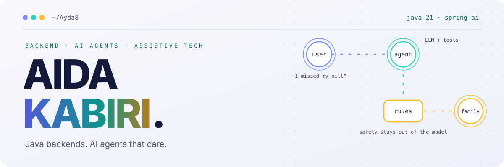

<div align="center">
  <picture>
    <source media="(prefers-color-scheme: dark)" srcset="assets/header-dark.svg">
    
  </picture>
</div>

<div align="center">
  
</div>

<div align="center">
  
  <a href="https://github.com/Ayda8?tab=followers"></a>
  
  
</div>


## `$ whoami`

```java
var aida = new Developer(
    "Aida Kabiri",                                   // name
    "Java Backend Developer · AI Engineering",       // role
    List.of("Spring Boot", "Spring AI", "JPA"),      // daily drivers
    List.of("Oracle", "PostgreSQL"),                 // where the data lives
    "B.Sc. Computer Science, 2023 – present",        // education
    "AI agents for assistive technology",            // what I'm building
    "Tehran, Iran"                                   // based in
);
```

I build backend systems in Java: enterprise information systems, and before that digital wallet,
payment and transaction products. Now I'm taking that engineering discipline into LLM applications.

My current project is an AI agent that helps people with disabilities and older adults manage their
medication, and keeps their family in the loop. The rule I build by: **an LLM may talk, but it never
decides anything safety-critical.** Those decisions live in plain, tested Java code, and every change
to the agent is measured with evals before it ships.


## `$ ls ~/projects`

<table>
  <tr>
    <td width="50%" valign="top">
      <h3>🩺 Caregiver Agent</h3>
      <p>An LLM agent that manages medication schedules and alerts caregivers. Runs fully local with Ollama and keeps working without internet. Safety rules in a deterministic rule engine, guarded by ArchUnit; evals before prompts.</p>
      <p><code>Java 21</code> <code>Spring Boot 3.5</code> <code>Spring AI</code> <code>Ollama</code> <code>Flyway</code></p>
      
    </td>
    <td width="50%" valign="top">
      <h3>🪙 <a href="https://github.com/stupidprogrammer4/amu-pulse">Amu Pulse</a></h3>
      <p>Precious-metals price tracking with AI-scored market signals, built as a team. I built the identity module (JWT refresh tokens stored as SHA-256 hashes, login audit log) and the news crawler.</p>
      <p><code>Python</code> <code>FastAPI</code> <code>Dishka</code> <code>PostgreSQL</code></p>
    </td>
  </tr>
  <tr>
    <td width="50%" valign="top">
      <h3>🎓 University Management System</h3>
      <p>Enrollment with capacity and timetable-conflict checks, batch enrollment, weighted-GPA transcripts as PDFs, role-based access. Built in a structured mentorship program.</p>
      <p><code>Spring Boot</code> <code>JSF / PrimeFaces</code> <code>Oracle</code> <code>JasperReports</code></p>
    </td>
    <td width="50%" valign="top">
      <h3>🖼️ Lumina</h3>
      <p>An art gallery web app, made as a gift for a painter in my family.</p>
      <p><code>Spring Boot</code> <code>PostgreSQL</code> <code>JWT</code> <code>React / Vite</code> <code>Docker</code></p>
    </td>
  </tr>
</table>


## `$ mvn dependency:tree`

<div align="center">

**Backend**<br>


**AI engineering**<br>


**Data**<br>


**Frontend · Build · Ops**<br>


</div>


## `$ ./stats --live`

<div align="center">
  <a href="https://github.com/Ayda8">
    
  </a>
  <a href="https://github.com/Ayda8?tab=repositories">
    
  </a>
</div>

<div align="center">
  
</div>


## `$ cat principles.md`

> **Safety lives in code, not in prompts.** If a mistake can hurt someone, a tested rule decides, not a model.<br>
> **Measure before you tune.** Evals first, then prompts, then models.<br>
> **Write the decision down.** Every important choice gets an ADR, so future me knows *why*.


## `$ curl aida.contact`

<div align="center">
  <a href="mailto:aydakabiri71@gmail.com"></a>
  <a href="https://github.com/Ayda8"></a>
</div>

<br>

<div align="center">
  <sub><code>System.out.println("Thanks for stopping by ☕");</code></sub>
</div>
